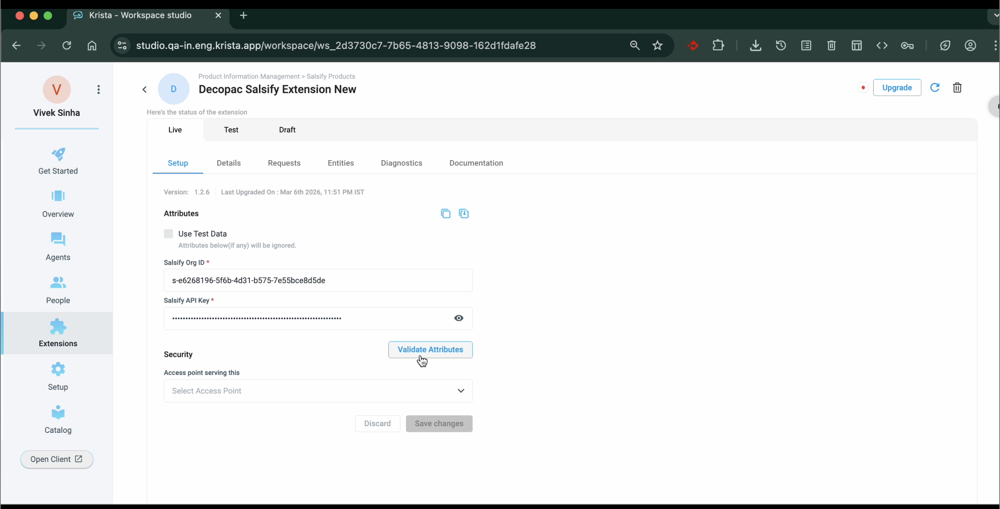
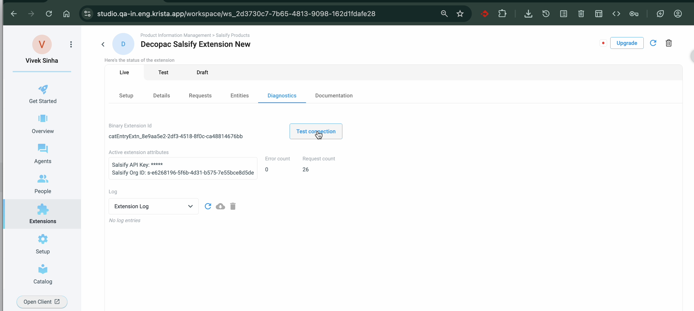

# Extension Configuration

## Overview

The Salsify Extension requires two configuration parameters to connect to the Salsify PXM API: your **Salsify Org ID** and your **Salsify API Key**. These are entered once in the extension Setup tab and stored securely in the Krista platform.

---

## Configuration Parameters

| Parameter | Type | Required | Description | Example |
|-----------|------|----------|-------------|---------|
| Salsify Org ID | Text | ✅ Yes | Your Salsify organisation identifier. Found in your Salsify account URL or admin settings. | `"my-salsify-org"` |
| Salsify API Key | Text (Secured) | ✅ Yes | Your personal or service-account Salsify API Key. Masked in the UI and encrypted at rest. | `"abc123...xyz"` |

> **⚠️ Warning**: The Salsify API Key grants access to your Salsify organisation data. Do not share it or store it in plain text outside the Krista platform.

---

## Step-by-Step Setup

1. Navigate to the **Salsify Extension** in the Krista Extensions catalogue.
2. Click **Setup** (or open the extension configuration panel).
3. Enter your **Salsify Org ID** in the provided field.
4. Enter your **Salsify API Key** in the secured field (the value will be masked as you type).
5. Click **Save** or **Validate**.
6. Krista automatically validates your credentials by making a live test request to the Salsify API. If validation fails, you will see an error message — see [Troubleshooting](#troubleshooting) below.



7. After a successful save, use the **Test Connection** button at any time to verify the credentials are still valid.



---

## Validation Behaviour

When you save the configuration, Krista performs the following checks **before** storing your credentials:

1. **Field presence check** — Both `Salsify Org ID` and `Salsify API Key` must be non-blank.
2. **Live API probe** — A minimal GET request is sent to the Salsify products endpoint (fetching 1 product) using the provided credentials. This confirms the credentials are accepted by Salsify before they are persisted.

If either check fails, the credentials are **not saved** and an error message is displayed.

---

## Credential Storage

Credentials are stored in the **Krista KeyValueStore** under a per-invoker key:

```
{invokerId}_salsify_credentials
```

The Krista platform encrypts KeyValueStore data at rest. The API Key is never written to application logs.

---

## Updating Credentials

To update your Org ID or API Key:

1. Open the extension Setup tab.
2. Edit the relevant field(s).
3. Save — the live validation probe runs again.
4. If validation passes, the new credentials replace the old ones in the KeyValueStore.

---

## Removing the Extension

When the Salsify Extension invoker is removed from Krista, all stored credentials are automatically deleted from the KeyValueStore. No manual cleanup is required.

---

## Security Considerations

- The API Key field is annotated `isSecured = true`, so Krista masks the value in the UI.
- Never log the API Key or pass it through insecure channels.
- Rotate the API Key in Salsify and update the extension configuration promptly if you suspect compromise.
- Each Krista invoker stores its own credentials independently; credentials from one invoker cannot be accessed by another.

---

## Troubleshooting

| Issue | Cause | Resolution |
|-------|-------|------------|
| "Salsify Org ID is required." | Org ID field was left blank | Enter your Salsify organisation ID |
| "Salsify API Key is required." | API Key field was left blank | Enter your Salsify API Key |
| "Invalid API token (401)." | The API Key is incorrect or has been revoked | Verify the API Key in your Salsify account settings. See [Creating a Salsify API Key](/pages/CreatingSalsifyAccount.md) |
| "Access denied (403)." | The API Key does not have permission for the specified Org ID | Confirm the Org ID matches the organisation your API Key belongs to |
| "Resource not found (404)." | The Org ID does not exist in Salsify | Double-check the Org ID value in your Salsify account URL |
| "Failed to connect to Salsify API." | Network error or Salsify outage | Check your network connectivity and Salsify service status |
| "No Salsify credentials configured." | Extension was not saved/validated yet | Complete Setup tab configuration and save |

---

## See Also

- [Authentication](/pages/Authentication.md)
- [Creating a Salsify API Key](/pages/CreatingSalsifyAccount.md)
- [Filter Products](/pages/FilterProducts.md)
